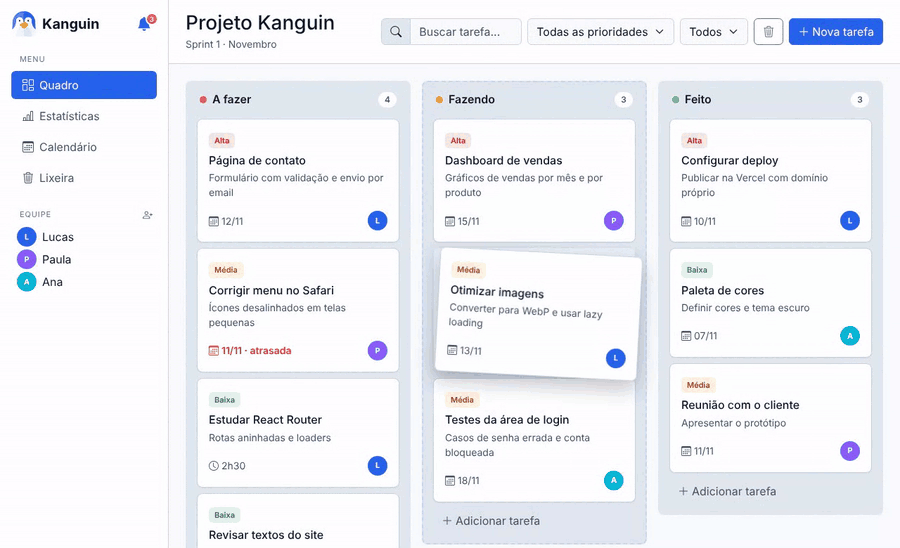
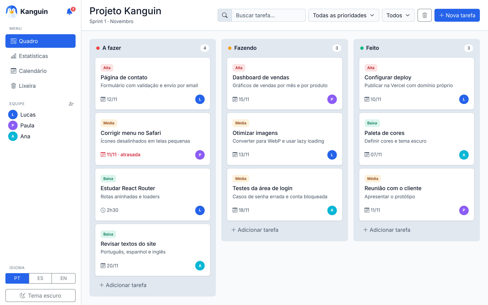
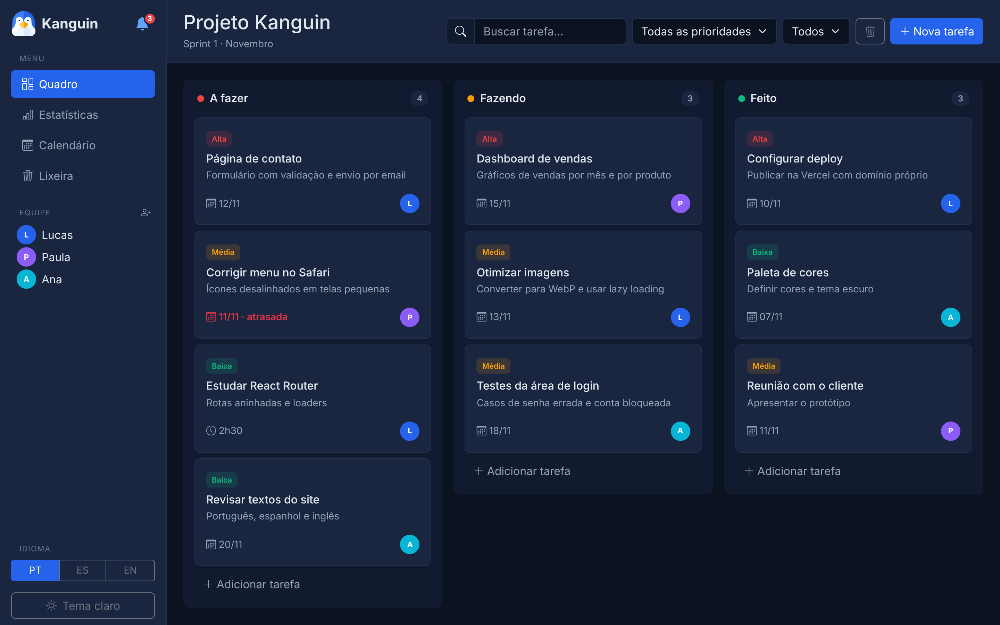
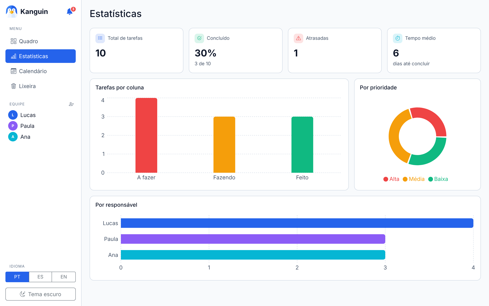
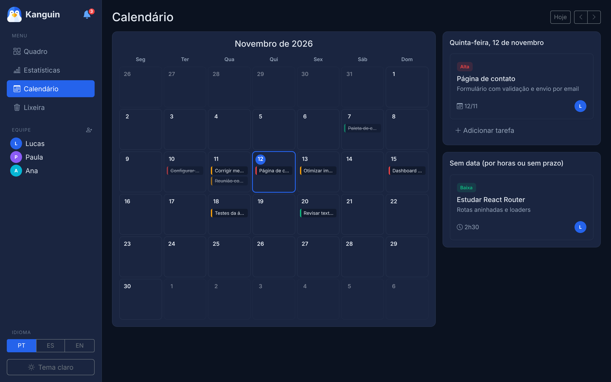
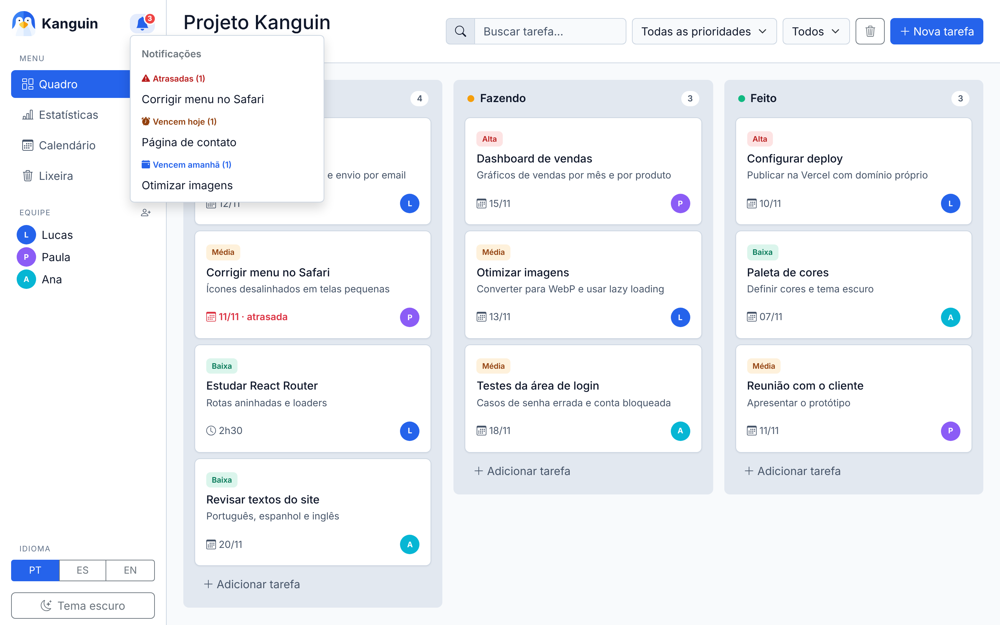
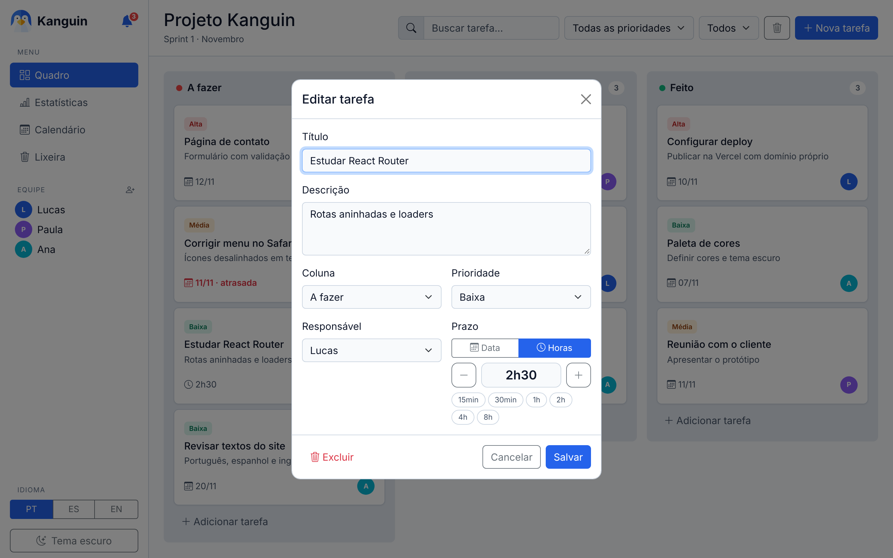
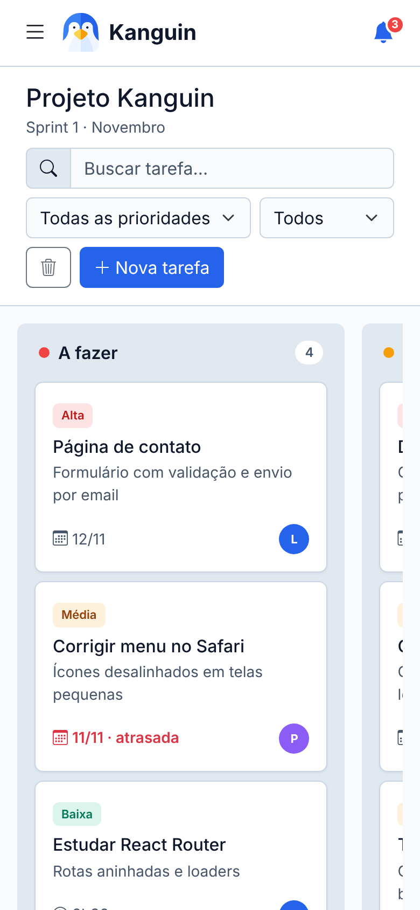
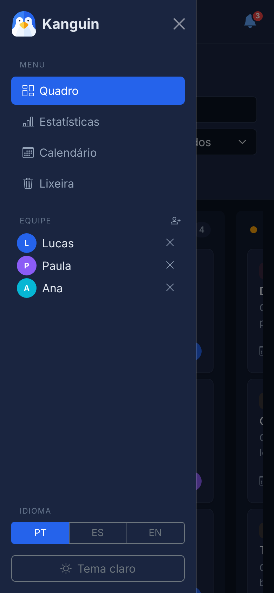

<p align="center">
  
</p>

<h1 align="center">Kanguin</h1>

<p align="center">
  Quadro Kanban para organizar tarefas, com estatísticas, calendário e interface em português, espanhol e inglês.
</p>

<p align="center">
  <a href="https://kanguin.vercel.app"><strong>Abrir o app: kanguin.vercel.app</strong></a>
</p>



## O que dá para fazer

- **Criar, editar e mover tarefas** entre "A fazer", "Fazendo" e "Feito", arrastando os cartões com o mouse ou com o dedo no celular.
- **Prazo por data ou por horas.** Uma tarefa pode ter data-limite (e fica marcada quando atrasa) ou só uma duração, como "Estudar React: 2h30".
- **Buscar e filtrar** por texto, prioridade e responsável.
- **Estatísticas:** total de tarefas, % concluído, atrasadas, tempo médio até concluir e gráficos por coluna, prioridade e responsável.
- **Calendário** do mês com as tarefas no dia do prazo. Clicando num dia, dá para ver as tarefas dele e criar uma nova já com aquela data.
- **Notificações** de tarefas atrasadas, que vencem hoje e que vencem amanhã. O número também aparece no título da aba.
- **Equipe:** adicionar e remover pessoas. As tarefas de quem sai da equipe continuam no quadro, com um aviso para reatribuir ou excluir.
- **Lixeira e "Desfazer":** nada é apagado de vez sem querer. Tarefas excluídas vão para a lixeira e podem ser restauradas a qualquer momento.
- **Tema claro e escuro**, que segue o tema do sistema na primeira visita.
- **Português, espanhol e inglês**, incluindo datas e números no formato de cada idioma.
- **Funciona no celular**, com menu lateral e colunas que deslizam para o lado.

Os dados ficam guardados no próprio navegador (`localStorage`). Cada pessoa que abre o link tem o seu quadro, e ninguém vê as tarefas de outra pessoa.

## Prints

| Quadro (tema claro) | Quadro (tema escuro) |
|---|---|
|  |  |

| Estatísticas | Calendário |
|---|---|
|  |  |

| Notificações | Editar tarefa (prazo por horas) |
|---|---|
|  |  |

| Celular | Menu no celular |
|---|---|
|  |  |

## Tecnologias

- [React 19](https://react.dev) + [Vite](https://vite.dev)
- [React Router](https://reactrouter.com) para as páginas
- [Bootstrap 5](https://getbootstrap.com), [React-Bootstrap](https://react-bootstrap.github.io) e [Bootstrap Icons](https://icons.getbootstrap.com)
- [dnd-kit](https://dndkit.com) para arrastar e soltar
- [Recharts](https://recharts.org) para os gráficos
- [i18next](https://www.i18next.com) para a tradução
- [Vercel](https://vercel.com) para publicar e medir as visitas (Web Analytics)

## Algumas decisões do projeto

- **Dados derivados em vez de estado duplicado.** As tarefas filtradas, as notificações e as estatísticas são calculadas a partir da lista de tarefas, então nunca ficam desatualizadas.
- **Um hook próprio, `useLocalStorage`,** com a mesma forma do `useState`, mas que salva no navegador.
- **Lazy loading.** As páginas de Estatísticas e Calendário só são baixadas quando alguém as abre. O JavaScript da primeira visita caiu de cerca de 820 KB para 470 KB.
- **Acessibilidade.** Os cartões funcionam pelo teclado (Tab e Enter), os botões só com ícone têm `aria-label`, e as cores do tema claro foram ajustadas para passar no contraste mínimo do WCAG.
- **Variáveis CSS** para a paleta de cores, integradas às variáveis do Bootstrap. O tema escuro só troca o valor das variáveis.

## Como rodar no computador

É preciso ter o [Node.js](https://nodejs.org) instalado.

```bash
git clone https://github.com/lucasomena920-lab/kanguin-colaborativo.git
cd kanguin-colaborativo
npm install
npm run dev
```

Depois é só abrir o endereço que aparece no terminal (normalmente `http://localhost:5173`).

## Estrutura

```
src/
├── components/   peças da interface (Card, Coluna, Modal, Sidebar...)
├── pages/        páginas inteiras (Estatísticas, Calendário, Lixeira)
├── hooks/        useLocalStorage
├── utils/        funções de cálculo (estatísticas, notificações, formatação)
├── i18n/         configuração e textos em pt, es e en
├── App.jsx       estado principal e rotas
└── index.css     paleta de cores e estilos
```

## Próximos passos

- Login e banco de dados, para usar o mesmo quadro em vários aparelhos e compartilhar com uma equipe de verdade.
- Testes automatizados com Vitest.

## Autor

Feito por **Lucas Omena**.
[LinkedIn](https://www.linkedin.com/in/lucas-omena-9414661b8) · [GitHub](https://github.com/lucasomena920-lab)

Ícone do pinguim adaptado de um ícone do [Flaticon](https://www.flaticon.com).

Licença [MIT](LICENSE).
